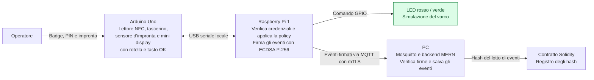

# Linee guida architetturali

## Schema dell'architettura

Il LED è rosso quando il varco simulato è bloccato. Se il Pi autorizza l'accesso, diventa verde per cinque secondi e poi torna rosso.

## Flusso utente

| Passo | Cosa fa o vede l'utente | Cosa succede nel prototipo |
| --- | --- | --- |
| 1. Avvicina il badge | Il display mostra «Avvicina il badge». Il LED è rosso. | Il lettore NFC passa l'UID all'Arduino, che lo inoltra al Pi. Il Pi cerca il badge, controlla che sia attivo e avvia una sessione breve associata all'operatore. |
| 2. Inserisce il PIN | Digita sul tastierino, vede `••••` e preme OK. Con la rotella può selezionare «Annulla». | L'Arduino invia al Pi il PIN insieme all'ID della sessione sul collegamento seriale locale. Il Pi verifica il PIN e applica il limite ai tentativi. |
| 3. Appoggia il dito | Il display mostra «Appoggia il dito». | Il Pi indica gli slot associati all'operatore del badge. L'utente appoggia il dito una volta. Se il sensore lo consente, confronta il campione con gli slot di quell'operatore. L'Arduino inoltra al Pi l'esito associato alla stessa sessione. |
| 4. Riceve l'esito | Il display mostra «Accesso consentito» e il LED diventa verde, oppure mostra «Accesso negato» e il LED resta rosso. | Il Pi applica la policy locale, controllando ruolo, turno e revoca. Chiude la sessione dopo la decisione e registra l'esito. |
| 5. Il terminale torna pronto | Dopo cinque secondi il LED torna rosso e il display torna a «Avvicina il badge». | Il Pi termina la finestra di accesso simulata e il terminale si prepara al tentativo successivo. |

Se il badge espone soltanto un UID statico, l'UID serve a identificare il badge registrato ed è copiabile. Verificheremo se il badge, il lettore e la libreria consentono una **challenge-response crittografica** per autenticare il badge prima di chiedere il PIN. Se è possibile solo leggere l'UID, nella demo possiamo mostrare che presentarne una copia lascia comunque da superare PIN e impronta.

## Responsabilità hardware

- **Elegoo Uno R3 - terminale utente.** Il firmware C/C++ si sviluppa con Arduino IDE. Legge NFC e tastierino, comunica con il sensore d'impronta e gestisce display, rotella e tasto OK. Invia gli input al Pi e mostra le istruzioni che riceve.
- **Raspberry Pi Zero W - controllore locale (Pi 1).** Il servizio gira in Python. Verifica il PIN, associa i risultati alla stessa sessione, applica la policy, comanda il LED tramite GPIO e firma gli eventi di audit. I LED sono collegati al Pi perché è il Pi a prendere la decisione.
- **PC - Mosquitto e backend MERN.** Riceve gli eventi, verifica le firme, li salva e invia periodicamente allo smart contract l'hash di un lotto di eventi.
- **Contratto Solidity - registro degli hash.** Si sviluppa e si testa con Hardhat. Registra gli hash pubblicati dall'account autorizzato del backend. Chi dispone degli eventi originali può ricalcolare l'hash e confrontarlo con quello registrato.

### Installazione a incasso di riferimento

Il pannello a vista ospita il display e le interfacce per badge, PIN e impronta. Arduino Uno e Raspberry Pi 1 sono alloggiati nella parete, dietro il pannello, con il cavo USB e i connettori interni. Per la demo con PIN fittizi assumiamo che il vano sia accessibile solo a chi si occupa della manutenzione. Con questa ipotesi, la seriale può viaggiare in chiaro.

L'incasso da solo non garantisce il perimetro fidato. Se rimuovere il frontale dà accesso al cavo o al bus del sensore, quei collegamenti vanno valutati separatamente. Il Pi controlla comunque fase e ID di sessione di ogni messaggio.

## Comunicazioni e cifratura

| Collegamento | Cosa viene mandato | Come viene protetto |
| --- | --- | --- |
| Periferiche ↔ Arduino | UID dal lettore, tasti premuti, comandi ed esito del sensore, istruzioni per il display. | I cablaggi interni rientrano nel perimetro fidato della demo. Un eventuale canale protetto Arduino-Pi copre la sola seriale USB. Il bus del sensore ha un perimetro di fiducia separato. |
| Arduino ↔ Pi 1 | UID, PIN, richiesta di verifica di un template, risultato biometrico e istruzioni per il display. | Per la demo con dati fittizi, la seriale può rientrare nel perimetro fidato se schede, cavo e connettori sono protetti e l'accesso fisico al bus è fuori dal modello di minaccia. Il Pi valida tipo, fase e ID sessione dei messaggi. Se il collegamento è esposto a lettura o iniezione, usare un canale autenticato e cifrato, con protezione contro il replay. |
| Pi 1 ↔ broker MQTT | Eventi di audit con ID pseudonimo, esito, orario, numero progressivo e versione della policy. | TLS 1.3 con mTLS cifra il traffico e autentica sia il gateway sia il broker tramite certificati. Il broker limita il gateway al topic assegnato. Il Pi firma inoltre gli eventi con ECDSA P-256, così la firma resta verificabile anche dopo il salvataggio. Riferimento: RFC 9846. |
| Backend → smart contract | Hash del lotto di eventi. | Il backend verifica le firme prima di calcolare l'hash e usa il proprio account autorizzato per registrarlo. Gli eventi completi restano nel database. |

### Prova dei template biometrici

Il badge identifica l'operatore e il Pi seleziona soltanto gli slot biometrici associati a lui. Con un template si fa un confronto 1:1. Con più template si confronta il campione con gli slot di quella persona, se il sensore lo permette. Evitare la ricerca indiscriminata nella memoria del sensore.

Se la prova conferma l'utilità di cinque slot per persona, un esempio di assegnazione è Gabriel negli slot 0–4 ed Enrico negli slot 5–9. Ogni slot contiene un template ottenuto con un'acquisizione distinta dello stesso dito, variando leggermente posizione o angolo di appoggio secondo la procedura del sensore. SQLite conserva l'associazione tra operatore e slot. Dopo badge e PIN, il confronto è limitato agli slot dell'operatore selezionato.

Confrontare 1, 2 e fino a 5 template con lo stesso numero di tentativi e la stessa soglia, usando nuove acquisizioni. Registrare rifiuti con il dito corretto, accettazioni con un dito diverso e tempo di risposta. Accettare il primo match può ridurre i rifiuti ma offre anche più occasioni di falso match. Selezionare il numero minimo che migliora la demo e verificare la cancellazione di tutti gli slot associati. Le prove su pochi partecipanti sono esplorative. [NIST SP 800-76-2, sezioni 10.4–10.5](https://nvlpubs.nist.gov/nistpubs/specialpublications/nist.sp.800-76-2.pdf)

## Gestione dei dati e significato degli eventi

Il PIN è presente in memoria durante l'inserimento e la verifica. Sul Pi si conserva il verificatore derivato con **Argon2id e salt**. Il template dell'impronta rimane nel sensore se il modulo scelto supporta il flusso descritto. PIN, immagini e template restano fuori dai log, da MQTT e dalla blockchain.

Nel registro si prevedono eventi come `ACCESS_GRANTED`, `ACCESS_DENIED` ed eventualmente `SIMULATED_UNLOCK_ENDED`. Il verde indica che il Pi ha autorizzato lo sblocco simulato. Il log documenta quella decisione e la fine della finestra, senza attribuire all'utente un passaggio fisico.

## Funzionamento offline

Se cade il Wi-Fi, il Pi continua a verificare badge, PIN e impronta e a comandare il LED finché la policy locale è valida. Conserva gli eventi firmati in una coda locale e li sincronizza quando torna la rete. Una revoca fatta sul backend durante la disconnessione arriva al Pi alla riconnessione. La scadenza della policy limita il tempo per cui il gateway può usare le informazioni già in suo possesso.

## Prove dimostrative

Le tre prove usano lo stesso operatore.

1. **In turno, credenziali corrette.** Il LED passa da rosso a verde per cinque secondi e compare `ACCESS_GRANTED`.
2. **Fuori turno, stesse credenziali.** Il LED resta rosso e compare `ACCESS_DENIED` con motivo «fuori turno». Si vede la differenza fra identità verificata e accesso autorizzato.
3. **In turno, Wi-Fi spento.** Il LED diventa verde e l'evento resta sul Pi. Quando si riattiva la rete, lo stesso evento arriva al backend e la sua firma viene verificata.

## Decisioni consolidate dalle lezioni del progetto precedente

Le motivazioni, le evidenze nel codice di riferimento e le prove da eseguire sono raccolte in [docs/lessons_learned.md](docs/lessons_learned.md).

- **Sessioni.** Il Pi gestisce una sessione breve per tentativo con ID, utente, fase e scadenza. Accetta ogni fattore solo nella fase prevista. Annullamento, timeout e decisione invalidano la sessione; risultati tardivi o di un'altra sessione vengono rifiutati. Un solo flusso alla volta possiede le periferiche del terminale.
- **Identità.** L'ID operatore è stabile e separato dall'UID del badge e dallo slot biometrico. La riassegnazione di uno slot non trasferisce vecchie credenziali al nuovo utente.
- **Amministrazione ed enrollment.** Le operazioni amministrative richiedono autorizzazione sul servizio che le esegue. L'enrollment ha stati espliciti e attiva la credenziale solo dopo la conferma delle associazioni richieste. Errori parziali devono poter essere recuperati o ripuliti.
- **Revoca.** Lo stato di accesso e la pulizia fisica dei template sono distinti. Una pulizia fallita resta tracciata e ripetibile. Il funzionamento offline rispetta la scadenza della policy locale e la finestra dichiarata di mancata conoscenza delle revoche.
- **Audit.** Gli eventi hanno un identificativo univoco, una rappresentazione deterministica e una firma. Backend e coda persistente gestiscono riavvii e ritrasmissioni senza duplicare l'evento. Registrare separatamente ricezione, verifica e anchoring confermato.
- **Fiducia.** Documentare protezione delle chiavi, accesso ai cablaggi e limiti del gateway compromesso. La firma attesta il gateway; il significato fisico dipende dai suoi input. Per l'anchoring dichiarare chi controlla la rete e quali eventi sono già coperti da un deposito verificato.

## Scelte tecnologiche aperte - riunione del gruppo

**Stato: da compilare con tutti e tre i componenti.** Riunione prevista per l'11 novembre 2026. Questa sezione guida le decisioni e non assegna automaticamente uno stack.

### Come usare questa sezione

1. Confermare hardware disponibile, tempo e richieste dei docenti, incluso l'eventuale obbligo di implementare una primitiva crittografica.
2. Scegliere piattaforma blockchain e linguaggio del contratto insieme.
3. Definire protocolli, gestione delle identità e dati firmati prima di selezionare le librerie.
4. Provare sensore e badge. Valutare la cifratura sull'Uno se la seriale è fuori dal perimetro fidato.
5. Scegliere backend, storage, interfaccia e strumenti di verifica in base alle integrazioni necessarie.

Per ogni scelta registrare motivazione, riferimento al corso, prova minima, responsabile e stato. Un'opzione rimane aperta finché manca la prova che ne conferma la fattibilità. Le versioni saranno fissate dopo la scelta e prima dell'implementazione integrata.

Le linee guida precedenti costituiscono la base attuale: MQTT con mTLS, firme ECDSA P-256 e Argon2id per il PIN. La riunione deve confermare queste scelte e completarne i dettagli; eventuali cambiamenti vanno motivati e riportati anche nelle sezioni precedenti e in AGENTS.md.

### Priorità per la prima demo

| Priorità | Cosa decidere o verificare |
| --- | --- |
| **Essenziale** | Inventario hardware, lettura del badge e confronto 1:1, stack minimo sul Pi e sul backend, firma degli eventi, mTLS MQTT, protezione del PIN, piattaforma del contratto e rete per eseguirlo. |
| **Da definire durante l'implementazione** | Formato dei messaggi, versioni delle librerie, QoS, frequenza dei lotti, parametri Argon2id e gestione dei certificati. |
| **Dipende dal perimetro fisico** | Cifratura autenticata della seriale Arduino-Pi. La decisione dipende da chi può leggere o modificare il traffico sul cavo. |
| **Verifica aperta** | Challenge crittografica del badge. L'UID basta a identificare il badge nella prima demo; la challenge serve a dimostrare il possesso crittografico. |

### Opzioni facoltative

| Opzione | Quando aggiunge valore |
| --- | --- |
| **Testnet pubblica** | Serve a provare il deployment su una rete esterna e a mostrare la transazione in un explorer pubblico. Per dimostrare registrazione e verifica dei lotti basta una rete di sviluppo locale. Nel repository dei colleghi non risultano blockchain, contratti o testnet. [Reti di sviluppo Ethereum](https://ethereum.org/developers/docs/development-networks/) |
| **Merkle tree** | Serve a verificare l'inclusione di un singolo evento senza recuperare tutto il lotto. Per verificare il lotto intero basta il suo hash. |
| **Funzioni avanzate della dashboard** | Filtri, gestione amministrativa e schermate aggiuntive possono seguire la prima integrazione. React è lo stack scelto per la dashboard. |
| **Docker** | Può semplificare l'avvio riproducibile dei servizi sul PC. |
| **Secure element** | Protegge la chiave privata dall'estrazione quando questo rischio rientra negli obiettivi della demo. |
| **JWT** | È un'opzione per le sessioni dell'interfaccia web se quella funzionalità viene sviluppata. |

### A. Blockchain e smart contract

Il gruppo ha scelto Solidity per il contratto EVM e Hardhat per compilazione, test e deploy. Per la demo è proposta una rete Hardhat locale sul PC.

| Argomento | Domanda da risolvere | Percorsi da discutere | Decisione del gruppo |
| --- | --- | --- | --- |
| Piattaforma e linguaggio | Su quale piattaforma eseguiamo il contratto? | EVM con contratto Solidity. | **Confermato: Solidity con Hardhat.** |
| Rete della demo | Dove eseguiamo il contratto? | Rete Hardhat locale sul PC. Documentare che la rete è controllata dal gruppo. | Proposta per la demo. |
| Funzioni del contratto | Quali dati registra e chi può scriverli? | Hash del lotto, ID lotto e autorizzazione del publisher. Definire duplicati, amministratore e cambio del publisher. | Da compilare |
| Formazione del lotto | Come colleghiamo eventi e hash depositato? | Ordinamento e serializzazione deterministici; hash dell'intero lotto o Merkle root se serve provare singoli eventi. Definire frequenza o dimensione del lotto. | Da compilare |
| Integrazione e conferma | Come il backend sa che il deposito è riuscito? | Client della piattaforma scelta, ricevuta/esito verificato, ritentativi e recupero dopo riavvio. | Da compilare |
| Sviluppo e test | Come compiliamo, testiamo e distribuiamo? | Hardhat per testare deposito autorizzato, rifiuto di scritture non autorizzate e gestione dei duplicati. | **Hardhat confermato.** Versioni e comandi da definire. |

Fonti tecniche: [linguaggi Ethereum](https://ethereum.org/developers/docs/smart-contracts/languages/), [reti di sviluppo Ethereum](https://ethereum.org/developers/docs/development-networks/), [chaincode Fabric](https://hyperledger-fabric.readthedocs.io/en/latest/chaincode_lifecycle.html).

### B. Crittografia e gestione delle chiavi

Compilare una scelta per ogni uso. La curva della firma dei log, quella usata da TLS e quella prevista dalla blockchain possono essere diverse. Firma, cifratura, hash e derivazione del PIN svolgono funzioni distinte.

| Uso | Cosa occorre decidere | Base attuale e punti aperti | Decisione del gruppo |
| --- | --- | --- | --- |
| Firma degli eventi | Come rendiamo interoperabili Pi e backend? | ECDSA P-256 sul Pi, verifica in Node. Prova iniziale con firma DER e stessi byte del payload su entrambi. | P-256 è la base. Libreria, encoding e formato firmato da validare. |
| Seriale Arduino-Pi | Il cavo e i connettori sono nel perimetro fidato? | USB interna all'alloggiamento protetto. Validare messaggi, fase e ID di sessione. | **Demo: seriale in chiaro con PIN fittizi.** |
| MQTT con mTLS | Versione TLS, certificati, algoritmo delle chiavi, CA e rinnovo/revoca. | TLS 1.3 previsto. Distinguere autenticazione con certificato, accordo di chiavi e cifratura della sessione. Confermare compatibilità broker/client. | Da compilare |
| PIN | Libreria, parametri di derivazione e politica dei tentativi. | Argon2id con salt sul Pi. Misurare memoria e latenza sull'hardware disponibile; definire contatori, blocco e persistenza al riavvio. | Da compilare |
| Hash degli eventi e dei lotti | Funzione di hash, encoding, ordine e concatenazione. | Da specificare. SHA-256 è un candidato per i dati applicativi; se si usa EVM distinguere Keccak-256 da SHA3-256 nelle operazioni della piattaforma. | Da compilare |
| Firma della transazione blockchain | Chi firma il deposito? | L'account EVM del backend firma con secp256k1. Il backend verifica la firma P-256 del gateway prima di formare il lotto. | Configurare l'account di sviluppo. |
| Ciclo di vita delle chiavi | Come vengono generate, installate, protette, sostituite e revocate? | Distinguere chiave seriale, firma gateway, TLS/CA e publisher blockchain. Decidere se protezione software è sufficiente alla demo e dichiararne i limiti. | Da compilare |

**Ruolo delle curve.** ECDSA P-256 firma gli eventi del gateway. In TLS, ECDHE può concordare le chiavi di sessione e i certificati ECDSA possono autenticare i partecipanti. La cifratura del traffico usa chiavi simmetriche. Su EVM, secp256k1 firma la transazione del backend che deposita il lotto. Argon2id deriva il verificatore del PIN.

**Prima prova di firma.** Firmare sul Pi un payload di prova con una chiave P-256, trasferire a Node payload, firma e chiave pubblica e verificare la firma. Ripetere dopo aver cambiato l'esito nel payload e attendersi un rifiuto. Concordare encoding della firma e byte del payload prima di collegare MQTT. [API crittografiche Node.js](https://nodejs.org/api/crypto.html)

Per ciascun algoritmo scelto aggiungere riferimento ufficiale e libreria/versione verificata. La citazione di un algoritmo o una RFC non definisce da sola un protocollo completo.

### C. Hardware, comunicazione e applicazione

| Argomento                   | Domande per il gruppo                                            | Vincoli o alternative da valutare                                                                                                                                        | Decisione del gruppo                                                                                                                                                                                                                                                                                       |
| --------------------------- | ---------------------------------------------------------------- | ------------------------------------------------------------------------------------------------------------------------------------------------------------------------ | ---------------------------------------------------------------------------------------------------------------------------------------------------------------------------------------------------------------------------------------------------------------------------------------------------------- |
| Inventario hardware | Quali modelli e quantità abbiamo? | Elegoo Uno R3, due Raspberry Pi Zero W, lettore SPI MFRC522, sensore ottico AS608, tastierino 3×4, display OLED I²C con rotella e tasto OK, LED RGB. | Inventario rilevato. Mappare pin e verificare livelli elettrici prima del cablaggio completo. |
| Badge | Leggiamo l'UID o possiamo autenticare il badge? | Usare DumpInfo per il primo test e verificare separatamente la challenge. | Chip del badge da identificare quando disponibile. |
| Biometria | Quanti template associare a ogni operatore? | Partire da un template per operatore, acquisito seguendo la procedura del modulo. Provare 2 e poi fino a 5 solo se riducono i rifiuti legittimi in misura utile. Verificare sul modello reale capacità, confronto mirato agli slot dell’operatore, latenza e cancellazione. | Numero di slot da confermare con prove hardware. |
| Firmware | Come sviluppiamo per l'Uno? | C/C++ e librerie compatibili con l'hardware. | **Arduino IDE confermato.** |
| Servizio locale sul Pi | Quale linguaggio gestisce seriale, sessioni, policy e LED? | Python per seriale, GPIO, SQLite, verifica PIN, firma e MQTT. | **Python confermato.** Provare installazione delle librerie e prestazioni sul Pi Zero W. |
| Messaggi seriali | Come riconosciamo messaggi completi, malformati o fuori fase? | Messaggi testuali con campi separati da `\|` e fine riga `\n`. Limitare la lunghezza, validare tipo e campi, conservare gli zeri iniziali del PIN e verificare fase, ID sessione e timeout. La risposta del Pi indica il passo successivo o l’errore. | **Scelto per la demo.** |
| MQTT | Come consegniamo gli eventi dal Pi al backend? | Mosquitto sul PC, mTLS e ACL per topic. Il Pi pubblica gli eventi firmati con QoS 1. Node.js usa MQTT.js, verifica la firma e salva in MongoDB con ID evento univoco. Node conferma il salvataggio su un topic di conferma dedicato e il Pi segna l’evento come sincronizzato in SQLite. Se la conferma manca, il Pi ritrasmette lo stesso ID. | **Confermato: Mosquitto, mTLS, QoS 1 e deduplicazione.** Versione MQTT e configurazione dei topic da definire. |
| Backend                     | Quale stack riceve, verifica e rende consultabili gli eventi?    | Node.js riceve gli eventi via MQTT e verifica le firme. Express espone le API.                                                                                           | **Confermato: Node.js + Express.**                                                                                                                                                                                                                                                                         |
| Storage                     | Dove conserviamo operatori, policy, coda offline e audit?        | SQLite sul Pi conserva operatori, policy e coda offline. MongoDB sul PC conserva gli eventi verificati, con un identificativo univoco per deduplicare le ritrasmissioni. | **Confermato: SQLite sul Pi, MongoDB sul backend.**                                                                                                                                                                                                                                                        |
| Policy e offline            | Come rappresentiamo ruolo, turno, revoca e scadenza?             | Regole locali esplicite o strumento studiato nel corso se motivato; decidere aggiornamento autenticato, versione e gestione del tempo non affidabile.                    | Da compilare                                                                                                                                                                                                                                                                                               |
| Dashboard e amministrazione | Quali pagine servono e come autentichiamo gli amministratori?    | React per la dashboard. Le API Express applicano i permessi. Schermate e autenticazione amministrativa da definire.                                                      | **React confermato.**                                                                                                                                                                                                                                                                                      |

#### Prime prove hardware

1. **Badge RC522.** Verificare pin, alimentazione e livelli logici. Nell'Arduino IDE caricare [DumpInfo](https://github.com/miguelbalboa/rfid/tree/master/examples/DumpInfo), aprire il monitor seriale e annotare UID e tipo PICC. La lettura UID è la prima prova. Per il challenge-response verificare chip e libreria a parte. La libreria MFRC522 standard non implementa l'autenticazione AES dei DESFire. [Libreria MFRC522](https://github.com/miguelbalboa/rfid)
2. **Impronta AS608.** Registrare due template distinti dello stesso dito in due slot. Durante il tentativo acquisire il dito una volta, estrarre le caratteristiche in un buffer e caricare nell'altro, in sequenza, i template associati all'operatore. Provare il confronto dopo ogni caricamento, verificando che il campione sia riutilizzabile e che un dito diverso venga respinto. Se i comandi non sono supportati sul modulo, rivalutare il flusso prima di fissare il numero di slot.
3. **Terminale locale.** Integrare badge, PIN, una scansione e LED sul Pi con SQLite. In parallelo verificare Python → Node con la prova della firma. Collegare poi MQTT e il deposito del lotto.

### D. Prove, avvio e organizzazione

| Argomento | Risultato da concordare | Decisione del gruppo |
| --- | --- | --- |
| Validazione | Strumenti di test per linguaggi scelti; prove su sessioni, permessi, replay, firme, revoca, riavvii, offline e contratto. Distinguere test simulati e hardware. | Da compilare |
| Avvio riproducibile | Versioni delle dipendenze, configurazione di esempio e comandi per ciascun dispositivo. Valutare script, servizi o container in base all'hardware. | Da compilare |
| Dati e privacy | Utenti fittizi, eventuali impronte reali, cancellazione e conservazione, contenuto dei log. | Da compilare |
| Responsabilità | Referente hardware/protocollo; referente identità/policy; referente backend/audit/blockchain. Revisione incrociata e integrazione condivisa. | Da compilare |

### Scheda da compilare per ogni scelta

- **Argomento e stato:** da discutere / da provare / confermato.
- **Scelta e versione:** da compilare.
- **Motivo e compromesso accettato:** da compilare.
- **Lezione, slide o esempio del corso:** da compilare.
- **Documentazione primaria:** da compilare.
- **Prova minima e risultato atteso:** da compilare.
- **Responsabile e revisore:** da compilare.
- **Esito della prova e limiti rimasti:** da compilare.

### Esito della riunione

- **Partecipanti:** da compilare.
- **Decisioni confermate:** firmware con Arduino IDE, servizio locale in Python, contratto Solidity con Hardhat e seriale USB interna in chiaro per la demo. SQLite sul Raspberry Pi al varco e MERN sul PC (MongoDB, Express, React e Node.js). Il Pi prende le decisioni di accesso usando i dati locali. Gli eventi viaggiano tramite Mosquitto con mTLS e QoS 1, con conferma applicativa dopo il salvataggio e deduplicazione per ID.
- **Decisioni rinviate e prove necessarie:** da compilare.
- **Attività assegnate e prossima verifica:** da compilare.
