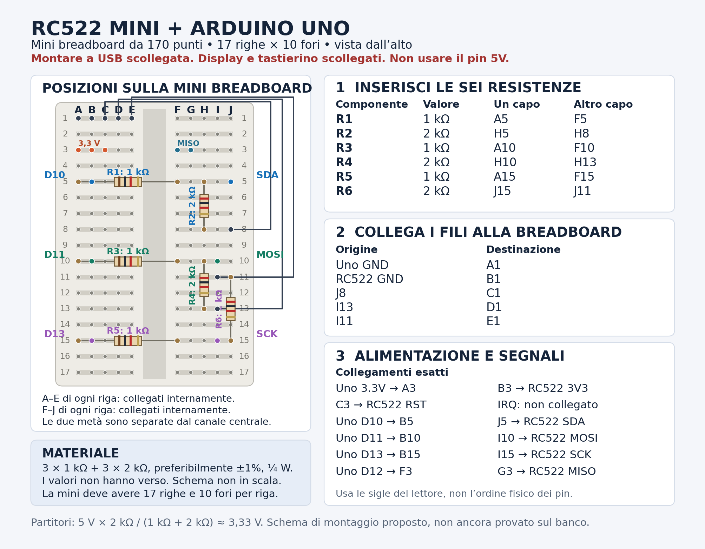

# RC522 MINI su mini breadboard da 170 punti

Schema di montaggio per la prova isolata con Elegoo Uno R3.
L'utente ha comunicato di aver completato il montaggio; esiti elettrici e
funzionali ancora da verificare. Il lettore usa SPI; il pin serigrafato `SDA`
è la selezione del lettore e in questo test corrisponde a D10 dell'Uno.

## Orientamento e limiti

La breadboard ipotizzata ha **17 righe e 10 colonne A–J**, con canale centrale
tra E e F. All'interno di una riga, A–E sono collegati fra loro e F–J sono
collegati fra loro; le due metà sono separate e le righe diverse non sono
collegate. Se le coordinate non sono stampate, assegnare A–E alla metà
sinistra, F–J alla destra e numerare da 1 a 17 dall'alto, guardando il lato
con i fori. Usare questa convenzione per tutto il montaggio. Il disegno non
è in scala. Non applicare queste coordinate a una mini con geometria diversa.

Montare tutto a USB scollegata. Display, tastierino e altre periferiche
rimangono scollegati. Non collegare il pin 5V dell'Uno al circuito.
I pin del lettore devono avere un contatto stabile; il modello è quello
mostrato nelle foto dell'utente, con le sigle `SDA`, `SCK`, `MOSI`, `MISO`,
`IRQ`, `GND`, `RST`, `3V3`. Seguire le sigle, non la posizione apparente
in una fotografia.

## Materiale

- 3 resistenze da **1 kΩ** e 3 da **2 kΩ**, preferibilmente ±1%, da ¼ W.
- Mini breadboard da 170 punti.
- Cavetti adatti ai connettori effettivamente montati sull'Uno e sul lettore.

Le resistenze non hanno polarità. Le bande a quattro colori, quando presenti,
sono marrone–nero–rosso–oro per 1 kΩ e rosso–nero–rosso–oro per 2 kΩ (±5%).
A cinque bande ±1%: marrone–nero–nero–marrone–marrone per 1 kΩ;
rosso–nero–nero–marrone–marrone per 2 kΩ. Usare il valore identificato,
non il colore del corpo. Piegare i terminali senza far toccare conduttori
appartenenti a nodi diversi.

## 1. Posizionamento delle resistenze

| Resistenza | Valore | Un terminale | Altro terminale |
| --- | --- | --- | --- |
| R1 | 1 kΩ | A5 | F5 |
| R2 | 2 kΩ | H5 | H8 |
| R3 | 1 kΩ | A10 | F10 |
| R4 | 2 kΩ | H10 | H13 |
| R5 | 1 kΩ | A15 | F15 |
| R6 | 2 kΩ | J15 | J11 |

R1, R3 e R5 attraversano il canale centrale. Per esempio, R1 non è
cortocircuitata dalla breadboard: A5 e F5 sono su metà diverse della riga 5.
R6 va **verso l'alto**, dalla riga 15 alla 11: è intenzionale per far stare
tutti i componenti sulla mini. Lasciare libero il foro J13, sotto il corpo
possibile di R6; il filo di massa della riga 13 usa invece I13.

## 2. Massa comune

| Da | A | Colore indicativo |
| --- | --- | --- |
| Uno GND | A1 | Nero |
| RC522 GND | B1 | Nero |
| J8 | C1 | Nero |
| I13 | D1 | Nero |
| I11 | E1 | Nero |

I cinque fori A1–E1 formano il nodo di massa comune. Le righe destre 8, 13
e 11 sono così collegate a massa e chiudono i tre partitori.

## 3. Alimentazione e reset

| Da | A | Colore indicativo |
| --- | --- | --- |
| Uno 3.3V | A3 | Rosso |
| B3 | RC522 3V3 | Rosso |
| C3 | RC522 RST | Rosso/arancio |

Il reset è mantenuto a 3,3 V, coerentemente con il costruttore
`MFRC522 lettore(10, 0xFF)` dello sketch attuale: non viene comandato da un
pin a 5 V dell'Uno. Il reset software viene gestito dalla libreria.
La capacità dell'alimentazione va verificata sul modulo reale: un lettore
instabile richiede anche una verifica della 3,3 V sotto carico, non solo
modifiche al codice.

## 4. Segnali

| Da | A | Colore indicativo |
| --- | --- | --- |
| Uno D10 | B5 | Blu |
| J5 | RC522 SDA | Blu |
| Uno D11 | B10 | Verde |
| I10 | RC522 MOSI | Verde |
| Uno D13 | B15 | Viola |
| I15 | RC522 SCK | Viola |
| Uno D12 | F3 | Giallo |
| G3 | RC522 MISO | Giallo |
| RC522 IRQ | Non collegato | — |

I colori servono solo a riconoscere i collegamenti; non cambiano il circuito.
MISO porta il segnale dal lettore all'Uno e non attraversa un partitore.

## Funzionamento dei partitori

Per ciascuna uscita dell'Uno, 1 kΩ è fra uscita e ingresso del lettore;
2 kΩ è fra ingresso del lettore e massa. Idealmente:

`Vlettore = VUno × 2000 / (1000 + 2000)` → circa **3,33 V** con uscita a 5 V.

Il calcolo è statico. Fronti SPI, tensioni effettive, tolleranze, lunghezza
cavi e qualità dei contatti non sono misurati. Tenere i cavetti corti;
non dichiarare affidabile il bus finché le prove non sono ripetibili.
I partitori non sono la soluzione proposta per bus I²C bidirezionali.

## Avvio della prova

1. Controllare i collegamenti a USB scollegata, inclusa l'assenza di fili sul 5V.
2. Nell'Arduino IDE aprire prima `tests/test_rc522_spi/test_rc522_spi.ino`,
   selezionare Uno e la porta corretta; installare la libreria **MFRC522** se
   manca. Aprire il monitor seriale a **9600 baud** e verificare `PASS SPI`.
3. Caricare poi `tests/test_rc522/test_rc522.ino`, mantenendo **9600 baud**.
4. Verificare la versione del lettore e avvicinare il badge; annotare il tipo
   PICC. Per ripetere la lettura, allontanare e riavvicinare il badge.
5. Una versione `0x00` o `0xFF` indica mancata comunicazione secondo il test:
   scollegare USB e ricontrollare prima alimentazione, massa e partitori.

La lettura UID non dimostra autenticazione crittografica del badge. Non
pubblicare UID reali nelle evidenze condivise: usare esempi fittizi.
La versione della libreria e i risultati effettivi vanno registrati dopo
la prova. Non è stata effettuata una nuova compilazione AVR per questo schema.

## Fonti e verifiche

- [NXP MFRC522, datasheet rev. 3.9, 27 aprile 2016](https://www.nxp.com/docs/en/data-sheet/MFRC522.pdf),
  tabelle 150–151: limiti degli ingressi e alimentazione; sezione 8.1.1: SPI.
- [Libreria MFRC522](https://github.com/miguelbalboa/rfid),
  API usata dallo sketch presente nel repository.

Verificata a tavolino la connettività dei nodi rappresentati, l'assenza di
fori occupati due volte e la corrispondenza fra tabella e partitori.
Non sono state misurate tensioni, fronti SPI o consumi; non è stata eseguita
la prova sul lettore fisico.
