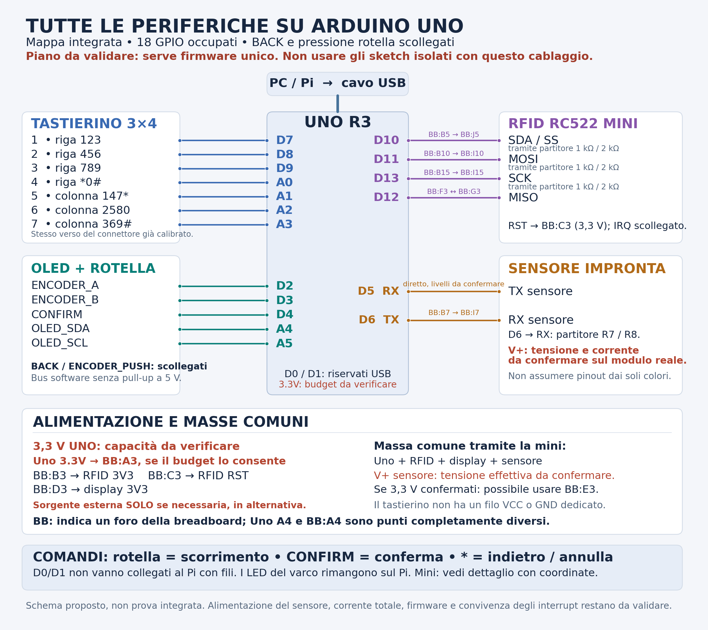
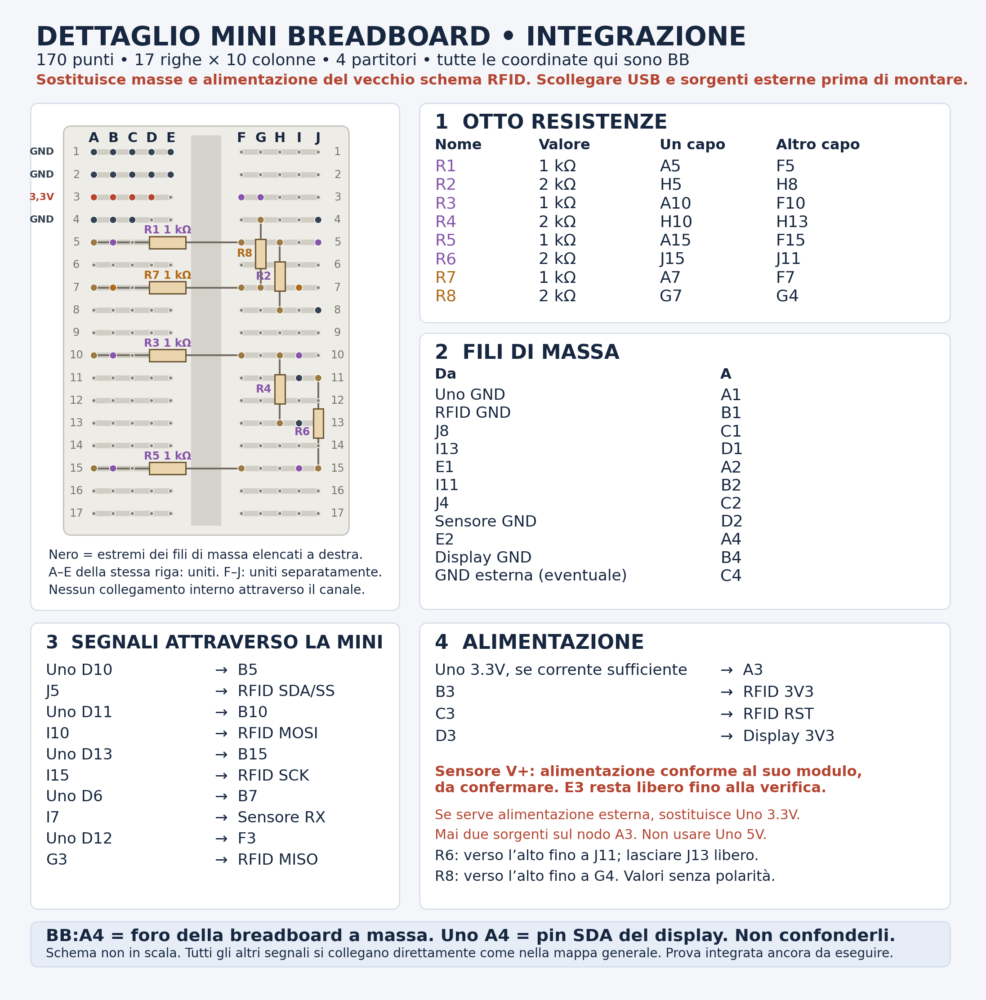

# Collegamento integrato delle periferiche su Uno R3

**Stato, 18 novembre 2026:** comandi di navigazione concordati; schema dei
segnali proposto e controllato a tavolino. Il funzionamento delle periferiche
separate non prova ancora il funzionamento contemporaneo. Questa consegna
contiene documentazione e immagini, non un firmware integrato eseguibile.

## Comandi concordati

| Azione | Comando |
| --- | --- |
| Scorrere le voci | Rotazione della rotella |
| Selezionare/confermare, incluso il PIN | Pulsante CONFIRM |
| Indietro nei menu | Tasto `*` del tastierino |
| Annullare un tentativo, anche durante l'impronta | Tasto `*`; invalidazione della sessione sul Pi |
| BACK e pressione della rotella | Scollegati, nessuna azione |

La sequenza badge → PIN → impronta → decisione del Pi rimane invariata.
L'implementazione integrata dovrà gestire annullamento, timeout e risultati
tardivi. La prova di annullamento non è ancora stata eseguita. `#` non riceve
una nuova funzione in questa decisione; il tastierino conserva tutti i suoi
sette collegamenti e dodici tasti.

## Mappa unica dei GPIO

| Pin Uno | Segnale | Note |
| --- | --- | --- |
| D0/RX, D1/TX | UART del convertitore USB–seriale | Riservati; Pi tramite USB, nessun filo verso GPIO del Pi |
| D2 | Display ENCODER_A | Ingresso, interrupt; senza pull-up interno a 5 V |
| D3 | Display ENCODER_B | Ingresso, interrupt; senza pull-up interno a 5 V |
| D4 | Display CONFIRM | Ingresso attivo LOW come nella prova, senza pull-up a 5 V |
| D5 | TX del sensore → RX software Uno | Direzione sensore → Uno; pin/colori da verificare sul modulo effettivo |
| D6 | TX software Uno → RX del sensore | Partitore R7/R8; non collegamento diretto a 5 V |
| D7 | Tastierino, riga `1 2 3` | Contatto 1 secondo l'orientamento usato nella calibrazione |
| D8 | Tastierino, riga `4 5 6` | Contatto 2 |
| D9 | Tastierino, riga `7 8 9` | Contatto 3 |
| A0 | Tastierino, riga `* 0 #` | Contatto 4, usato come GPIO digitale |
| A1 | Tastierino, colonna `1 4 7 *` | Contatto 5, GPIO digitale |
| A2 | Tastierino, colonna `2 5 8 0` | Contatto 6, GPIO digitale |
| A3 | Tastierino, colonna `3 6 9 #` | Contatto 7, GPIO digitale |
| D10 | RFID SDA/SS | Partitore R1/R2 |
| D11 | RFID MOSI | Partitore R3/R4 |
| D12 | RFID MISO | Segnale dal lettore all'Uno |
| D13 | RFID SCK | Partitore R5/R6 |
| A4 | Display OLED_SDA | Bus software: solo LOW o ingresso senza pull-up |
| A5 | Display OLED_SCL | Bus software: solo LOW o ingresso senza pull-up |

RFID RST rimane sulla sua alimentazione a 3,3 V, coerentemente con reset
software e pin `0xFF` della libreria. RFID IRQ, display BACK ed ENCODER_PUSH
rimangono scollegati. Non collegare i LED del varco all'Uno: sono sul Pi.

Conteggio: RFID 4 + impronta 2 + tastierino 7 + OLED 2 + encoder 2 + CONFIRM 1
= **18 GPIO**, oltre ai due riservati alla UART USB. Non rimangono GPIO liberi.
Le prese SDA/SCL e ICSP non creano GPIO aggiuntivi rispetto alle stesse linee
già assegnate. La mini breadboard non è un'espansione GPIO.

## Alimentazione: parte da validare prima dell'accensione simultanea

**Non alimentare automaticamente tutti i moduli dal pin 3.3V dell'Uno.**
Il riferimento Arduino Uno R3 dichiara 50 mA su tale uscita; il regolatore
della Elegoo effettiva e i consumi dei moduli vanno verificati. Un singolo
test riuscito non misura margini, picchi o cadute con tutti i carichi attivi.

Lo schema mostra il pin **3.3V dell'Uno come sorgente candidata**, non come
alimentazione simultanea già validata. Può alimentare il nodo comune solo
se la somma dei consumi massimi, inclusi i picchi, resta entro la capacità
verificata della scheda. Non è ancora stato misurato questo budget.

Una sorgente esterna regolata a 3,3 V è **solo un'alternativa se la capacità
dell'Uno risulta insufficiente**, non un nuovo componente già necessario o
approvato. In quel caso sostituire il filo Uno 3.3V → BB:A3 con l'uscita della
sorgente esterna e collegarne GND alla massa comune. Non unire le uscite di
due regolatori: **una sola sorgente sul nodo BB:A3**. L'Uno resta alimentato
via USB. Non collegare il 5V dell'Uno ai moduli a 3,3 V.

Questa revisione corregge la precedente rappresentazione della sorgente
esterna come necessaria: quella necessità non era stata dimostrata da misure.

**Sensore d'impronta:** il test esistente è indicato come AS608/JM-101B e
riporta alimentazione a 3,3 V, TX giallo e RX bianco. Il codice non sostituisce
il datasheet: modello esatto, ordine dei contatti, tensione di alimentazione,
livelli UART e corrente devono essere confermati sulla documentazione del
produttore del modulo reale. Nel disegno il V+ del sensore termina quindi su
un'alimentazione indicata come **da confermare**, non su una tensione imposta
per tutti i modelli. Collegarlo al nodo a 3,3 V comune solo se questa
tensione e il dimensionamento sono confermati; altrimenti usare l’alimentazione
prescritta dal produttore, con massa comune e livelli UART compatibili.

Le etichette TX/RX sono riferite al dispositivo: TX sensore va al RX software
Uno D5; TX Uno D6 va al RX sensore attraverso il partitore. Il partitore
proposto fornisce circa 3,33 V da 5 V: verificarne la compatibilità con il
modulo effettivo. Non dedurre tolleranza a 5 V da una prova riuscita.

Display e controlli mantengono il funzionamento senza pull-up a 5 V della
prova precedente. Presenza e valori dei pull-up sul modulo restano non
misurati. Non applicare indiscriminatamente Wire o INPUT_PULLUP a quei pin.
Il tastierino passivo è un circuito separato: i suoi pin possono essere
scansionati come nella prova dedicata, senza alimentazione propria.

## Mini breadboard: piano dei quattro partitori

Si assume una mini da **170 punti, 17 righe e colonne A–J**. Le coordinate
con prefisso **BB:** indicano la breadboard; quelle con **Uno** indicano la
scheda. Esempio: `BB:A4` è un nodo di massa di questo piano e **non** il pin
Uno A4, che porta SDA. Se mancano le sigle, assegnare A–E a sinistra e F–J a
destra del canale; righe numerate dall'alto. Cinque fori di ogni metà della
stessa riga sono collegati; metà opposte e righe diverse sono separate.

Questo piano **sostituisce la distribuzione di massa e alimentazione della
prova RFID isolata**; non basta aggiungere fili al vecchio schema. Montare
con USB e alimentazioni esterne scollegate. Usare contatti saldati/stabili.

### Resistenze: quattro da 1 kΩ e quattro da 2 kΩ

| Componente | Valore | Primo capo BB | Secondo capo BB | Uso |
| --- | --- | --- | --- | --- |
| R1 | 1 kΩ | A5 | F5 | RFID SS |
| R2 | 2 kΩ | H5 | H8 | RFID SS → GND |
| R3 | 1 kΩ | A10 | F10 | RFID MOSI |
| R4 | 2 kΩ | H10 | H13 | RFID MOSI → GND |
| R5 | 1 kΩ | A15 | F15 | RFID SCK |
| R6 | 2 kΩ | J15 | J11 | RFID SCK → GND |
| R7 | 1 kΩ | A7 | F7 | Uno TX → sensore RX |
| R8 | 2 kΩ | G7 | G4 | Sensore RX → GND |

Valori preferibilmente ±1%, da ¼ W; resistenze senza polarità. R6 e R8 vanno
verso righe con numero minore. Non far toccare terminali di nodi diversi;
lasciare J13 libero sotto il possibile ingombro di R6.

### Fili di massa

| Da | A |
| --- | --- |
| Uno GND | BB:A1 |
| RFID GND | BB:B1 |
| BB:J8 | BB:C1 |
| BB:I13 | BB:D1 |
| BB:E1 | BB:A2 |
| BB:I11 | BB:B2 |
| BB:J4 | BB:C2 |
| Sensore GND | BB:D2 |
| BB:E2 | BB:A4 |
| Display GND | BB:B4 |
| GND sorgente esterna 3,3 V, solo se utilizzata in alternativa | BB:C4 |

Se il sensore richiede una seconda sorgente, anche il suo negativo deve
essere unito alla massa comune, ad esempio tramite il foro libero BB:D4.
Non utilizzare i pin del tastierino come distribuzione di massa.

### Fili di alimentazione

| Da | A |
| --- | --- |
| Uno 3.3V, solo se il budget di corrente è verificato | BB:A3 |
| BB:B3 | RFID 3V3 |
| BB:C3 | RFID RST |
| BB:D3 | Display 3V3 |
| Alimentazione V+ conforme al modulo reale | Sensore V+ — connessione da confermare |

BB:E3 resta libero. Solo dopo conferma di alimentazione a 3,3 V e del budget
di corrente può essere usato per alimentare il sensore dalla stessa sorgente.
Se si adotta invece la sorgente esterna, il pin 3.3V dell'Uno va scollegato
da questo nodo: non alimentare BB:A3 da entrambe le sorgenti.

### Fili dei segnali che attraversano la mini

| Da | A |
| --- | --- |
| Uno D10 | BB:B5 |
| BB:J5 | RFID SDA/SS |
| Uno D11 | BB:B10 |
| BB:I10 | RFID MOSI |
| Uno D13 | BB:B15 |
| BB:I15 | RFID SCK |
| Uno D6 | BB:B7 |
| BB:I7 | Sensore RX |
| Uno D12 | BB:F3 |
| BB:G3 | RFID MISO |

Gli altri segnali si collegano direttamente secondo la mappa GPIO. Il
tastierino conserva l'orientamento della calibrazione; i contatti 1–7 vengono
spostati nell'ordine su D7, D8, D9, A0, A1, A2, A3. Non invertire il
connettore assumendo un ordine standard diverso da quello già misurato.

## Firmware e prove mancanti

**Non caricare gli sketch isolati con questa mappa completa collegata.**
Usano pin diversi e possono pilotare a 5 V segnali del display ora assegnati
ad altro. Serve un firmware unico con questa configurazione, bus software
del display, seriale sensore su D5/D6 e gestione coerente delle fasi.
Questo documento non crea tale firmware.

Verifiche richieste prima di considerare l'integrazione riuscita:

1. Conferma elettrica del sensore e dimensionamento dell'alimentazione.
2. Compilazione AVR e misura della RAM disponibile col firmware unico;
   i consumi dei singoli sketch non si sommano come misura del firmware finale.
3. Test seriale sensore a 57600 baud con display/encoder attivi, contando
   errori e timeout. SoftwareSerial può interferire con gli interrupt della
   rotella; un eventuale cambio baud richiede prova e registrazione.
4. Scansione tastierino senza PIN reali nei log, navigazione e CONFIRM.
5. Annullamento con `*` nelle varie fasi, timeout e rifiuto di risultati tardivi.
6. Ripetizione di lettura badge e impronta, disconnessioni e riavvii, con
   rifiuto sicuro di esiti incompleti. Nessuna autorizzazione autonoma sull'Uno.
7. Collegamento USB al Pi; sessione e policy gestite dal servizio locale,
   con i tre scenari dimostrativi delle linee guida preservati.

## Fonti e stato delle verifiche

- [Arduino Uno R3, pinout A000066](https://docs.arduino.cc/resources/pinouts/A000066-full-pinout.pdf):
  funzioni dei pin, linee duplicate, limite dichiarato di 50 mA sulla 3,3 V.
- [NXP MFRC522, rev. 3.9](https://www.nxp.com/docs/en/data-sheet/MFRC522.pdf):
  SPI e limiti elettrici del chip.
- [ArduinoCore-avr, SoftwareSerial](https://github.com/arduino/ArduinoCore-avr/blob/master/libraries/SoftwareSerial/src/SoftwareSerial.cpp):
  temporizzazione e gestione degli interrupt.
- Per sensore e display restano necessari i documenti del produttore del
  modello esatto; le sole etichette commerciali non li sostituiscono.

Verificati a tavolino unicità dei 18 GPIO e connettività dei quattro
partitori, separazione fra alimentazione e massa e assenza di fori assegnati
a più terminali. Non sono state eseguite misure elettriche, compilazione del
firmware integrato o prove contemporanee delle periferiche.
